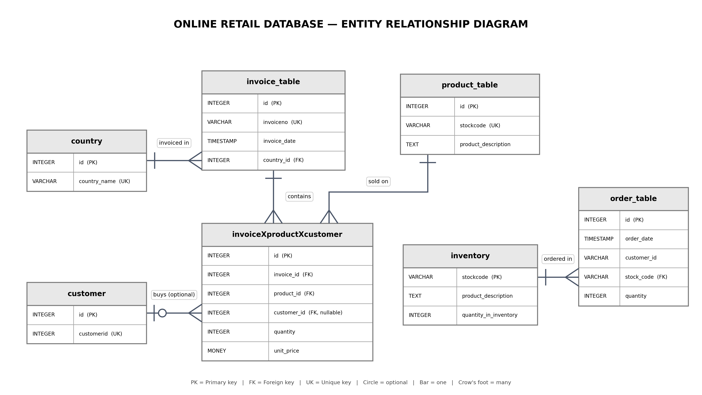

# Design Document

By Mohaiminul Islam

Video overview: <URL HERE>

## Scope

**Purpose.** The database stores and analyzes the transactions of a UK-based online gift retailer, using the UCI *Online Retail* dataset (invoices from December 2010 to December 2011). It turns one flat, repetitive CSV table into a normalized PostgreSQL schema so that questions about customers, products, countries and revenue can be answered with clean SQL. A small inventory module (stock table, orders table and a trigger) is added to demonstrate a complete database system, not just a reporting database.

**In scope**

* Invoices (orders), identified ny invoiceno.
* Products, identified by their stock code
* Customers, identified by their customer ID
* Countries in which invoices were placed
* Cancellations (invoice numbers starting with `C`, which carry negative quantities)
* A demo inventory: stock levels per product and new orders that reduce them automatically

**Out of scope**

* Suppliers, purchasing, shipping, payments and returns handling
* Personal customer details (names, addresses, e-mail)
* Product categories, brands or any product attributes beyond a description
* Real stock levels (the dataset has none, so the inventory numbers are synthetic)


## Functional Requirements

**A user should be able to**

* See the top customers by total spending, together with the countries they ordered from (`top_customers` view)
* Find the best-selling and the most-returned products
* Analyze revenue over time (monthly revenue and seasonality)
* Identify repeat customers and one-time customers
* Detect customers who ordered from more than one country
* Run data-quality checks (duplicate rows, missing values per column)
* Place a demo order and see the stock of that product decrease immediately

**Beyond the scope of a user**

* Editing historical transactions through the design (the schema is built for loading and analysis, not for a live shop)
* Forecasting, pricing or recommendation features
* Tracking stock movements other than new orders (restocking, cancellations and edits are not automated)

## Representation

### Data preparation

The raw CSV is loaded with `COPY` into a staging table, `online_retail`, which is the single source for all other tables. Before loading, the data was profiled and cleaned:

| Finding | Decision |

| Exact duplicate rows exist | Removed with `SELECT DISTINCT` into a new table |
| One stock code can have several descriptions | Keep the longest non-empty description per stock code, so each product has exactly one description |
| 1,454 rows have no description | Left as `NULL` (a product with no known name is stored without one) |
| 135,080 rows have no customer ID (guest purchases) | Left as `NULL`; no fake "unknown" customer is created, because it would merge all anonymous buyers into one |
| A few customers appear under several countries | The country is stored on the **invoice**, not on the customer (verified: no invoice has more than one country) |
| The same product has different prices over time (including `$0.00` rows) | `unit_price` is stored on the invoice line, not on the product |
| The same invoice can contain the same product on several lines with different quantities | The line table has its own `id` and no unique constraint on (invoice, product) |

### Entities

**`online_retail` (staging table)**

| Attribute | Type | Why |
|---|---|---|
| invoiceno | varchar(20) | Cancellations start with a letter (`C`), so it cannot be an integer |
| stockcode | varchar(20) | Codes such as `85123A` and `POST` contain letters |
| description | text | Free text of unknown length |
| quantity | int | Whole units; negative for cancellations |
| invoicedate | timestamp | Date and time of the invoice |
| unitprice | money | Price per unit, as in the source |
| customerid | integer | IDs are whole numbers (converted from the CSV text) |
| country | varchar(50) | Country name |

No constraints, because this table mirrors the raw file and is used for cleaning.

**`country`**

| Attribute | Type | Constraints |
|---|---|---|
| id | serial | `PRIMARY KEY` |
| country_name | varchar(30) | `NOT NULL`, `UNIQUE` |

A lookup table, so each country name is stored once. `UNIQUE` prevents duplicate countries.

**`customer`**

| Attribute | Type | Constraints |
|---|---|---|
| id | serial | `PRIMARY KEY` |
| customerid | integer | `NOT NULL`, `UNIQUE` |

`customerid` is the business identifier from the dataset, and the surrogate `id` is the key the other tables reference. Only identified customers are stored: guest purchases have no row here.

**`product_table`**

| Attribute | Type | Constraints |
|---|---|---|
| id | serial | `PRIMARY KEY` |
| stockcode | varchar(20) | `NOT NULL`, `UNIQUE` |
| product_description | text | nullable |

One row per product. The description is nullable because some stock codes have no description at all.

**`invoice_table`**

| Attribute | Type | Constraints |
|---|---|---|
| id | serial | `PRIMARY KEY` |
| invoiceno | varchar(20) | `NOT NULL`, `UNIQUE` |
| invoice_date | timestamp | `NOT NULL` |
| country_id | int | `FOREIGN KEY` to `country(id)` |

One row per invoice (the order header). Date and country belong to the invoice as a whole, so they are stored here once and not repeated on every line.

**`invoiceXproductXcustomer` (invoice lines)**

| Attribute | Type | Constraints |
|---|---|---|
| id | serial | `PRIMARY KEY` |
| invoice_id | int | `NOT NULL`, `FOREIGN KEY` to `invoice_table(id)` |
| product_id | int | `NOT NULL`, `FOREIGN KEY` to `product_table(id)` |
| customer_id | int | nullable, `FOREIGN KEY` to `customer(id)` |
| quantity | int | `NOT NULL` |
| unit_price | money | `NOT NULL` |

One row per item on an invoice, linking the invoice, the product and the (optional) customer. `customer_id` is nullable for guest purchases. `money` was chosen to match the source column and to make revenue sums display as currency.

**`inventory` (demo)**

| Attribute | Type | Constraints |
|---|---|---|
| stockcode | varchar(20) | `PRIMARY KEY` |
| product_description | text | nullable |
| quantity_in_inventory | int | `NOT NULL`, `CHECK (quantity_in_inventory >= 0)` |

Current stock per product. The `CHECK` constraint makes it impossible for stock to go negative: an order larger than the available stock is rejected.

**`order_table` (demo)**

| Attribute | Type | Constraints |
|---|---|---|
| id | serial | `PRIMARY KEY` |
| order_date | timestamp | `NOT NULL` |
| customer_id | varchar(20) | `NOT NULL` |
| stock_code | varchar(20) | `FOREIGN KEY` to `inventory(stockcode)` |
| quantity | int | `NOT NULL` |

New orders in the demo. The foreign key guarantees that only products that exist in `inventory` can be ordered.

### Relationships


## Optimizations

* **Unique indexes.** The `UNIQUE` constraints on `country_name`, `customerid`, `stockcode` and `invoiceno` create indexes automatically. They speed up the joins that look up ids during loading and enforce one row per entity.
* **Foreign key indexes.** PostgreSQL does not index foreign key columns by itself, so indexes are added on the columns most used in joins and grouping:

  ```sql
  CREATE INDEX idx_invoice_country  ON invoice_table(country_id);
  CREATE INDEX idx_line_invoice     ON invoiceXproductXcustomer(invoice_id);
  CREATE INDEX idx_line_product     ON invoiceXproductXcustomer(product_id);
  CREATE INDEX idx_customer_id   ON invoiceXproductXcustomer(customer_id);
  ```
* it's also with the  idx_customer_id the query time is reduced from 30.343 ms to 0.788 ms.(given in schema.sql)

* **View `top_customers`.** It stores the query for total spending per customer (cancellations excluded) together with the list of countries the customer ordered from. It hides a four-table join and an aggregation, so the "top customers" question is just `SELECT * FROM top_customers LIMIT 10`. Since it is a view, it always reflects the current data.
* **Trigger `update_inventory_trigger`.** After each insert in `order_table`, the trigger subtracts the ordered quantity from `inventory`. Stock stays correct without any application code, and the `CHECK` constraint rejects an order if the stock would become negative.
* **Normalization itself** is the main optimization: the staging table repeats the product description, country and date on every row, while the normalized tables store each fact once.

## Limitations

* **Customer is stored on the invoice line, not on the invoice.** A customer belongs to a whole invoice, so storing `customer_id` on every line repeats it and could in theory give two lines of the same invoice different customers. Moving it to `invoice_table` would be cleaner.
* **Guest purchases are invisible to customer analysis.** About a quarter of the rows have no customer ID, so customer-level results (top customers, repeat buyers) cover only identified customers.
* **Country is a property of the invoice.** The design cannot say where a customer "really" lives, only where each invoice was placed. Customers who appear in two countries keep both.
* **Non-product stock codes are included.** Codes such as `POST`, `M` (manual) and `BANK CHARGES` are services or adjustments, not products, and some descriptions are internal notes. They are kept because they are part of the revenue data, but they can distort product rankings.
* **Cancellations are not linked to the original invoice.** A cancellation is a separate invoice with negative quantities and no reference to the order it cancels. Revenue by month is therefore a net figure, while `top_customers` and the best-seller query exclude cancellations, so the numbers are not directly comparable.
* **Exact duplicate rows were removed.** Some may have been genuine repeated scans of the same item, so total revenue may be slightly understated.
* **`money` type.** It depends on the server locale and has limited rounding control. `numeric(10,2)` would be more portable.
* **The inventory data is synthetic.** The dataset contains no stock levels, so every product starts with 1,000 units. `order_table.customer_id` is not a foreign key to `customer`, and `inventory` is not linked to `product_table`.
* **The trigger handles inserts only.** Cancelling, editing or deleting an order does not restore the stock, and there is no restocking table.
